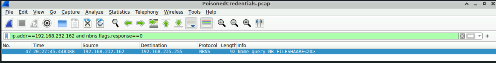
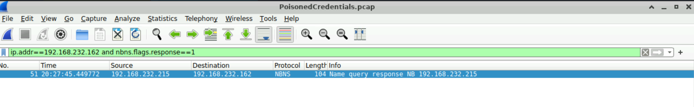
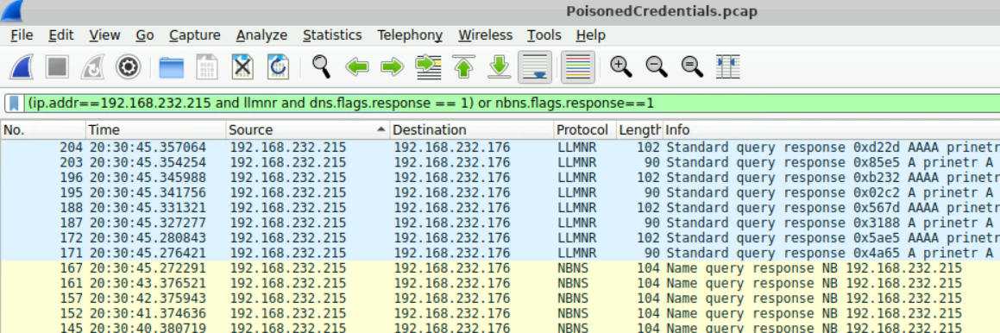
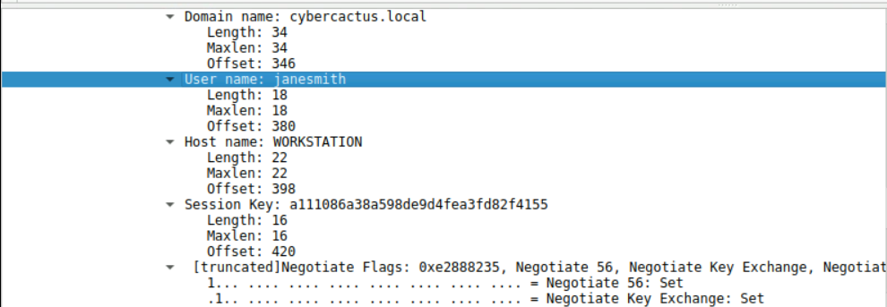
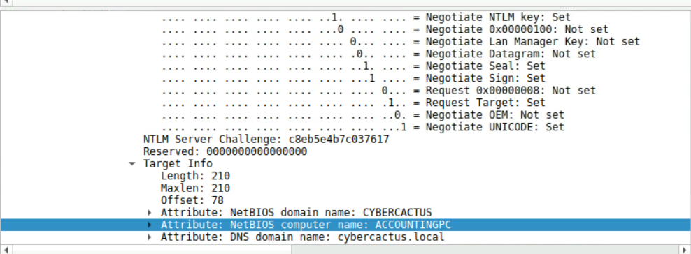

# CyberDefenders — PoisonedCredentials

**Category:** Network Forensics (PCAP)  ·  **Evidence:** `PoisonedCredentials.pcap`  ·  **Tool:** Wireshark

---

## Scenario

The security team detected a surge in suspicious network activity, with concern that **LLMNR** and **NBT-NS** poisoning attacks may be occurring. The task: investigate the packet capture, confirm whether poisoning occurred, identify the rogue host and victims, and determine what was compromised.

## Overview

LLMNR and NBT-NS are **fallback** name-resolution protocols — used only when DNS fails. The Protocol Hierarchy showed both among the most frequent protocols, the first sign of heavy name-resolution fallback.

Victim hosts were multicasting/broadcasting for services (a file share, a printer), each answered by a single host: `192.168.232.215`. The decisive detail: the requested names were **misspelled** (`FILESHAARE`, `prinetr`) — yet `192.168.232.215` still answered, claiming to own them. A legitimate host only answers for its own name; one host claiming multiple different (and impossible, misspelled) names is a poisoner (classically the **Responder** tool). That identifies `192.168.232.215` as rogue.

`192.168.232.148` was initially suspected but **ruled out** — it only answered for its legitimate role (domain master browser) and was already in session before the broadcast, behaviour inconsistent with a responder.

The payoff: once a victim connected to the rogue host believing it was the file share, its machine **authenticated automatically over SMB**, leaking `cybercactus.local\janesmith` (host `WORKSTATION`) in the NTLM session-setup. The attacker's real prize is the NTLMv2 response in that exchange — cracked offline to recover the password. **MITRE ATT&CK: [T1557.001](https://attack.mitre.org/techniques/T1557/001/).**

**Hosts:** `192.168.232.215` rogue · `192.168.232.162` & `192.168.232.176` victims · `192.168.232.148` legitimate domain master browser (ruled out)

---

## Analysis

### Q1 — Mistyped query from 192.168.232.162

Filter the host's NBT-NS *queries* (not responses); the mistyped name is in the packet info.

```
ip.addr == 192.168.232.162 and nbns.flags.response == 0
```



**Answer:** `FILESHAARE` (mistyped NBT-NS query for *fileshare*)

### Q2 — Rogue machine IP

Flip to *responses* — whoever answers a query for a non-existent name is the poisoner.

```
ip.addr == 192.168.232.162 and nbns.flags.response == 1
```



**Answer:** `192.168.232.215`

### Q3 — Second affected machine

Pivot off the rogue IP; list its LLMNR + NBT-NS responses and read the destinations.

```
(ip.addr == 192.168.232.215 and llmnr and dns.flags.response == 1) or nbns.flags.response == 1
```



**Answer:** `192.168.232.176`

### Q4 — Compromised username

The victim authenticates automatically over SMB. The NTLM session-setup (NTLMSSP_AUTH) exposes domain, username, hostname and session key.



**Answer:** `janesmith` (domain `cybercactus.local`). The NTLMv2 response sent alongside is the stolen credential, crackable offline.

### Q5 — Hostname accessed via SMB

The server-side NTLM challenge's **Target Info** carries the NetBIOS computer name.



**Answer:** `ACCOUNTINGPC`

---

## Indicators of Compromise

| Indicator | Value |
|---|---|
| Rogue / poisoner host | `192.168.232.215` |
| Victim 1 | `192.168.232.162` (mistyped `FILESHAARE`) |
| Victim 2 | `192.168.232.176` (poisoned LLMNR/NBT-NS, `prinetr`) |
| Legitimate host (ruled out) | `192.168.232.148` (domain master browser) |
| Compromised account | `cybercactus.local\janesmith` |
| Victim hostname (NTLM AUTH) | `WORKSTATION` |
| SMB session computer name | `ACCOUNTINGPC` |
| NTLM Server Challenge | `c8eb5e4b7c037617` |
| Mistyped queries | `FILESHAARE`, `prinetr` |

## MITRE ATT&CK

| Tactic | Technique | Evidence |
|---|---|---|
| Credential Access | T1557.001 – AiTM: LLMNR/NBT-NS Poisoning and SMB Relay | Rogue host answers LLMNR/NBT-NS queries to redirect victims |
| Credential Access | T1187 – Forced Authentication | Victim auto-authenticates to the fake SMB service, leaking its NTLMv2 hash |

## Lessons Learned

- The defining signature of LLMNR/NBT-NS poisoning is a host answering for names it does not own — misspelled or non-existent names that still get a confident response are the clearest proof.
- Multiplicity matters: one host claiming several different (and impossible) names cannot be legitimate. The pattern, not any single packet, is the tell.
- Noisy-but-benign Windows behaviour (browser elections, domain master browser) can mimic malice. `192.168.232.148` was ruled out with evidence — eliminating false positives is as important as finding the true positive.
- Poisoning is only the delivery mechanism; the objective is **forced authentication**. The NTLMv2 hash captured in the NTLMSSP_AUTH exchange is the credential the attacker cracks offline.

## Recommendations

- Disable LLMNR and NBT-NS where not required (Group Policy / DHCP) to remove the fallback protocols the attack depends on.
- Enforce SMB signing and prefer Kerberos over NTLM to blunt relay and reuse.
- Alert on any host answering LLMNR/NBT-NS queries for non-existent names — there is no legitimate use.
- Rotate credentials for `cybercactus.local\janesmith` and review `WORKSTATION` and `ACCOUNTINGPC` for follow-on activity.
