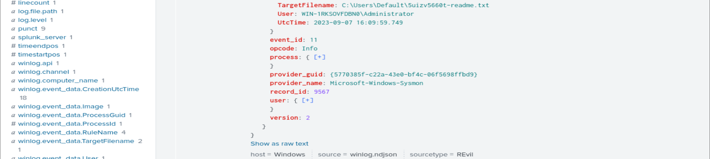
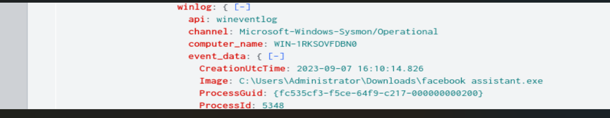
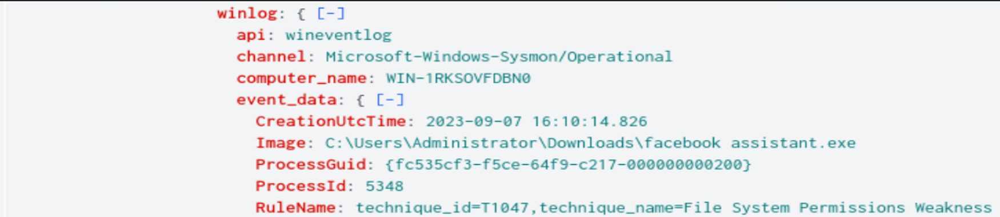
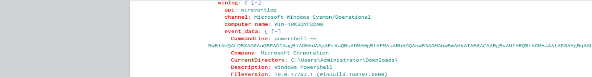
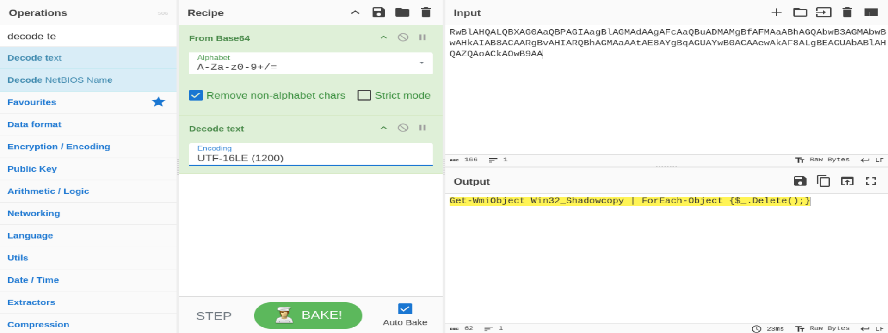
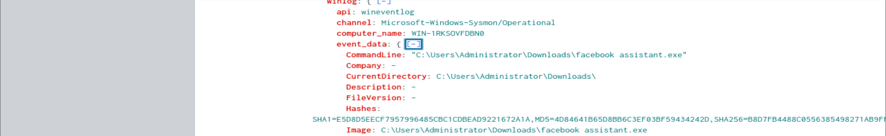
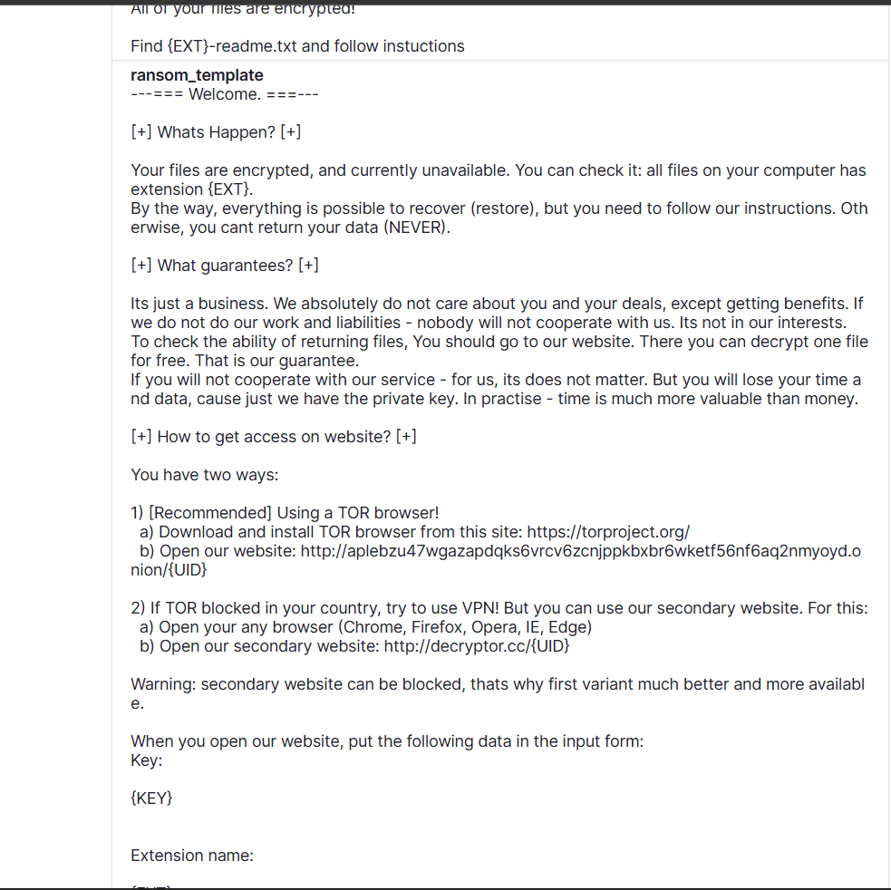

# CyberDefenders — REvil / GOLD SOUTHFIELD

**Category:** Threat Hunting (Splunk + Sysmon)  ·  **Evidence:** Sysmon logs in Splunk (`index=revil`)  ·  **Host:** WIN-1RKSOVFDBN0

---

## Scenario

A client suffered a ransomware attack that encrypted multiple machines (ransom note + changed desktop background). The task: use a Splunk SIEM of Sysmon logs from one encrypted machine to extract as much about the attack as possible.

## Overview

The attack is **REvil (Sodinokibi)**, the RaaS attributed to **GOLD SOUTHFIELD**. EventID 11 (FileCreate) is the natural starting point — and it surfaced **600+ files created in one minute from svchost.exe**.

**That burst was a false positive.** Verifying the `svchost.exe` identity (System32 path, `services.exe` parent, normal `-k` command line) and the target path (`C:\Windows\SoftwareDistribution\Download\...\$dpx$.tmp\`) showed it was **Windows Update**, not encryption. Ruled out.

The real attack: at `2023-09-07 16:09:50 (UTC)`, a masquerading dropper **`facebook assistant.exe`** (PID 5348) ran from Downloads, spawned PowerShell with an obfuscated `-e` command decoding to `Get-WmiObject Win32_Shadowcopy | ForEach-Object {$_.Delete();}` (shadow-copy deletion via WMI, **T1490**). It dropped `5uizv5660t-readme.txt` across the filesystem (per-infection ID/extension `5uizv5660t`). A hash lookup recovered the ransom-note template and the REvil onion domain.

> **Methodology note:** the loudest EventID 11 signal was benign. Verifying process identity (path, parent, command line) before building a theory prevented misattributing Windows Update as ransomware.

---

## Analysis

### Q1 — Ransom note filename

```
index=revil "event.code"=11 winlog.event_data.TargetFilename="*.txt"
```



**Answer:** `5uizv5660t-readme.txt`

### Q2 — Ransomware process ID



**Answer:** `5348` (facebook assistant.exe)

### Q3 — Executable location



**Answer:** `C:\Users\Administrator\Downloads\facebook assistant.exe`

### Q4 — Command disrupting system recovery

Pivot to child processes of the dropper; decode the obfuscated PowerShell (Base64 → **UTF-16LE**).

```
index=revil "event.code"=1 winlog.event_data.ParentImage="*facebook assistant.exe*"
```




**Answer:** `Get-WmiObject Win32_Shadowcopy | ForEach-Object {$_.Delete();}` — deletes all Volume Shadow Copies via WMI (T1490). Performed inside PowerShell, so no separate `vssadmin` event.

### Q5 — Executable SHA-256

```
index=revil "event.code"=1 winlog.event_data.Image="*facebook assistant.exe*"
```



**Answer:** SHA-256 `B8D7FB4488C0556385498271AB9F…` *(full value — TODO: paste from Splunk Hashes field)*
MD5 `4D84641B65D8BB6C3EF03BF59434242D` · SHA1 `E5D8D5EECF7957996485CBC1CDBEAD9221672A1A`

### Q6 — Attacker's onion domain

Hash → threat intel → full ransom-note template with the TOR payment URL.



**Answer:** `aplebzu47wgazapdqks6vrcv6zcnjppkbxbr6wketf56nf6aq2nmyoyd.onion`

---

## Indicators of Compromise

| Indicator | Value |
|---|---|
| Initial dropper | `facebook assistant.exe` |
| Location | `C:\Users\Administrator\Downloads\facebook assistant.exe` |
| PID | `5348` |
| MD5 | `4D84641B65D8BB6C3EF03BF59434242D` |
| SHA1 | `E5D8D5EECF7957996485CBC1CDBEAD9221672A1A` |
| SHA256 | `B8D7FB4488C0556385498271AB9F…` *(confirm full)* |
| Shadow-copy deletion | `Get-WmiObject Win32_Shadowcopy \| ForEach-Object {$_.Delete();}` |
| Ransom note | `5uizv5660t-readme.txt` |
| Per-infection ID / extension | `5uizv5660t` |
| C2 onion domain | `aplebzu47wgazapdqks6vrcv6zcnjppkbxbr6wketf56nf6aq2nmyoyd.onion` |
| Affected host | `WIN-1RKSOVFDBN0` |
| Attack start | `2023-09-07 16:09:50 (UTC)` |

## MITRE ATT&CK

| Tactic | Technique | Evidence |
|---|---|---|
| Initial Access / Execution | T1204.002 – User Execution: Malicious File | Masquerading `facebook assistant.exe` from Downloads |
| Execution | T1059.001 – PowerShell | `powershell -e <base64>` loader |
| Defense Evasion | T1047 – Windows Management Instrumentation | Shadow-copy deletion via WMI (Sysmon RuleName) |
| Impact | T1490 – Inhibit System Recovery | Decoded PS deletes all Volume Shadow Copies |
| Impact | T1486 – Data Encrypted for Impact | Mass encryption; `5uizv5660t` extension + ransom notes |
| Impact | T1491.001 – Internal Defacement | Desktop background changed |

## Lessons Learned

- **The loudest signal isn't always malicious.** A 600-file EventID 11 burst was Windows Update; verify process identity (path, parent, command line) before theorising.
- **Ransom-note drops** (new files) are a clearer EventID 11 signal than the encryption itself (in-place renames don't always fire FileCreate).
- **No `vssadmin` event ≠ shadow copies spared** — REvil deletes them via WMI inside PowerShell, so T1490 is evidenced by the decoded command's intent.
- **Obfuscated PowerShell needs the right encoding** — REvil uses UTF-16LE; the wrong one yields garbage.
- **A file hash is a pivot into threat intel** — it recovered the ransom-note template and onion domain absent from host telemetry.
