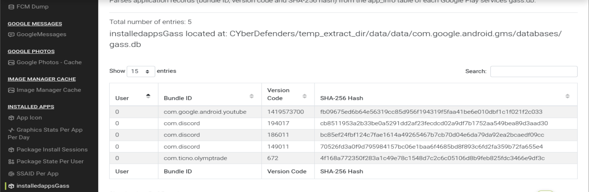
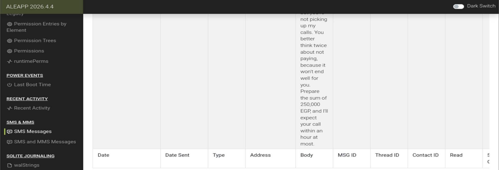
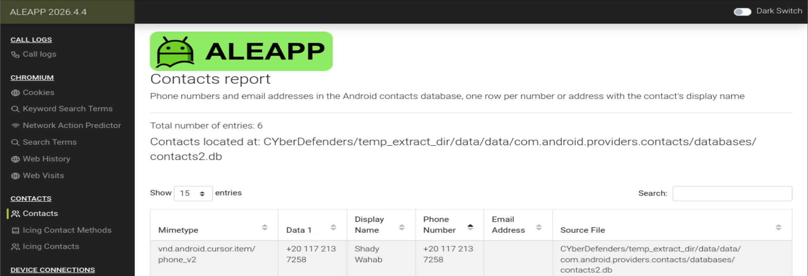
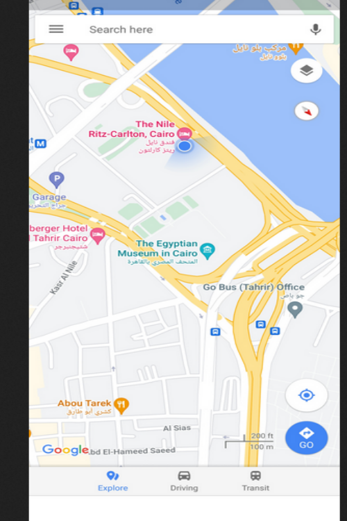
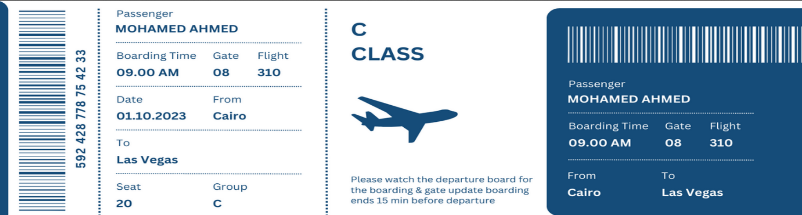
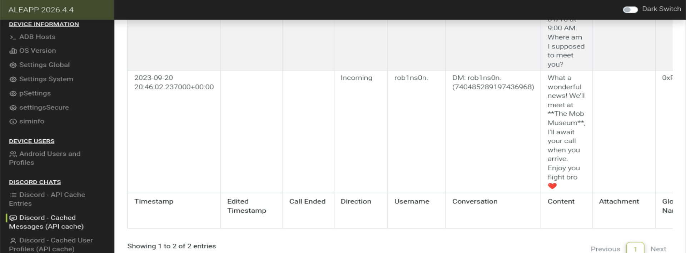

# CyberDefenders — The Crime Lab

**Category:** Mobile (Android) Forensics  ·  **Evidence:** Android filesystem extraction  ·  **Tool:** ALEAPP

---

## Scenario

A murder investigation. The victim's phone has been obtained as a key piece of evidence. Using witness statements and artifacts recovered from the device, the objective is to reconstruct the sequence of events leading up to the incident.

## Overview

The Android filesystem extraction is compressed to a zip/tar archive and processed with **ALEAPP** (Android Logs Events And Protobuf Parser), which organizes the artifacts into an interactive HTML report. Investigation starts with Device Information and Accounts to establish ownership, then follows the human timeline across communications, media, web history, location and system events.

The device belongs to **Mohamed Ahmed** (Google + Discord accounts). He used the **OlympTrade** trading app and fell into debt. His creditor, **Shady Wahab** (+20 117 213 7258), escalated from ~10 unanswered calls to an SMS demanding **250,000 EGP** within an hour. The victim had booked a flight Cairo → Las Vegas and arranged on Discord to meet **rob1ns0n** at **The Mob Museum**. Minutes after the threat, his web history shows him researching how to change his flight — an apparent attempt to flee. He was located at **The Nile, Ritz-Carlton (Cairo)**, not his residence. The same night, at **2023-09-20 23:55:49**, the device was **factory reset** — yet ALEAPP still recovered the data.

**Investigative conclusion:** Shady Wahab is the most strongly indicated person of interest; motive is the unpaid 250,000 EGP debt. The factory reset, on the night of the extortion deadline, is a key anti-forensic lead.

---

## Analysis

### Q1 — SHA-256 of the trading application

Installed Apps lists each app's bundle ID, version code and SHA-256. Only one is a trading platform: `com.ticno.olymptrade` (OlympTrade).

**Answer:** `4f168a772350f283a1c49e78c1548d7c2c6c05106d8b9feb825fdc3466e9df3c`

### Q2 — Amount owed

The creditor's SMS states the sum directly.

**Answer:** `250,000 EGP`

### Q3 — The creditor

The SMS sender's number, cross-referenced against Contacts, resolves to a name.

**Answer:** `Shady Wahab` (+20 117 213 7258)

### Q4 — Victim's location (Sep 20, 2023)

Recent Activity holds a cached map snapshot of the device's location.

**Answer:** `The Nile, Ritz-Carlton` (Cairo)

### Q5 — Intended destination

Google Photos holds a saved image of the boarding pass.

**Answer:** `Las Vegas` (Cairo → Las Vegas, Egypt Airlines flight 310, departs 01.10.2023)

### Q6 — Discord meeting point

The cached Discord reply names the meeting location.

**Answer:** `The Mob Museum` (Las Vegas)

---

## Timeline of Events

| Timestamp (UTC) | Event |
|---|---|
| 2023-09-19 23:06:07 | Flight ticket (Cairo → Las Vegas, Oct 1) saved to Google Photos |
| 2023-09-20 00:57:26 | Discord: victim tells rob1ns0n he booked the flight; asks where to meet |
| 2023-09-20 ~19:45:49 | Last of ~10 calls from Shady Wahab — all ignored / rejected |
| 2023-09-20 20:09:49 | SMS threat from Shady Wahab: pay 250,000 EGP, "call within an hour" |
| 2023-09-20 20:15:22 | Web history: victim researches how to change an already-booked flight |
| 2023-09-20 20:46:02 | Discord: rob1ns0n replies — meet at "The Mob Museum" |
| (Sep 20, 2023) | Location artifact: device at The Nile, Ritz-Carlton, Cairo |
| 2023-09-20 23:55:49 | Factory reset performed (anti-forensic event) |

*Timestamps are UTC as shown by ALEAPP; the device/victim were in Cairo (UTC+2/+3), so local times differ, though ordering is unaffected.*

## Key Evidence Summary

| Item | Value |
|---|---|
| Victim / device owner | Mohamed Ahmed |
| Linked accounts | Google, Discord |
| Trading app | com.ticno.olymptrade (OlympTrade) |
| Creditor / extortionist | Shady Wahab (+20 117 213 7258) |
| Amount owed | 250,000 EGP |
| Victim location (Sep 20) | The Nile, Ritz-Carlton, Cairo |
| Intended travel | Las Vegas (Egypt Airlines flight 310) |
| Discord contact | rob1ns0n |
| Meeting point | The Mob Museum |
| Anti-forensic event | Factory reset — 2023-09-20 23:55:49 |

## Lessons Learned

- Mobile forensics reconstructs a **human timeline** — the strongest evidence comes from correlating across artifact types (SMS, calls, chat, web history, media, location, system logs), not any single source.
- **Timezone discipline** matters: ALEAPP records timestamps in UTC; converting to the device's local time (Cairo, UTC+2/+3) is essential for interpreting "when."
- A **factory reset is not a dead end** — ALEAPP recovered substantial data despite one, and the reset event itself (timing, intent, actor) is high-value evidence.
- **Corroboration** strengthens findings: the SMS amount is confirmed as a debt by witness testimony, and the sender number is resolved to a named person via the contacts DB.
