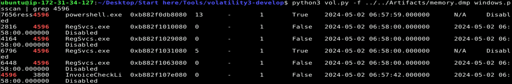
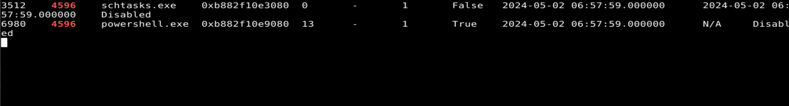
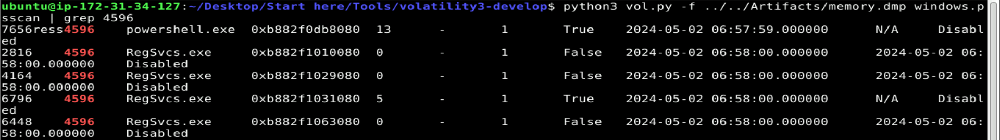
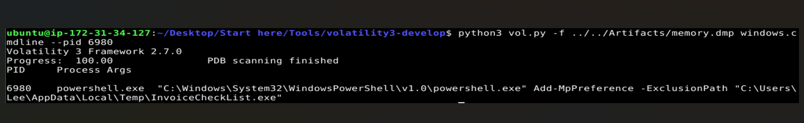
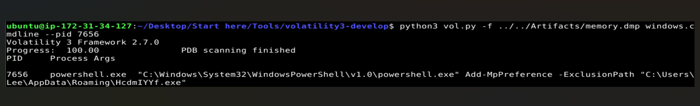
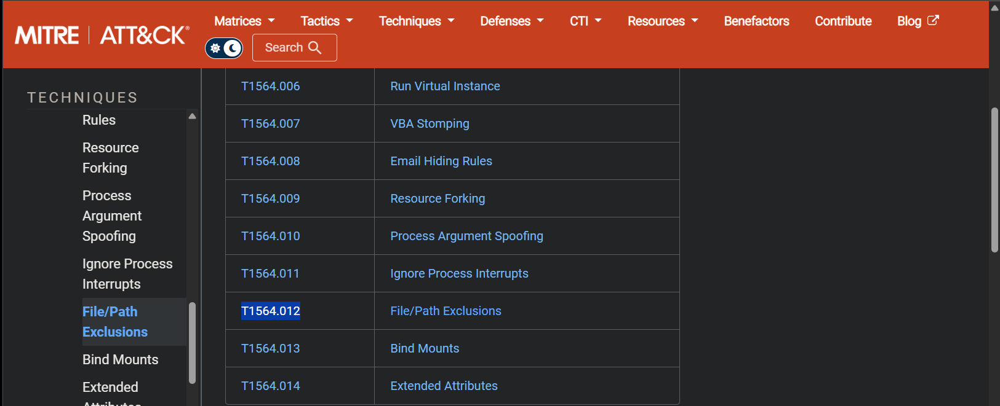
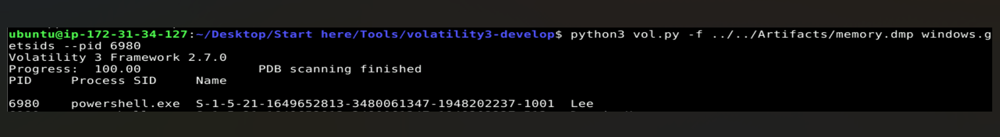

# CyberDefenders — Volatility Traces

**Category:** Memory Forensics (Volatility 3)  ·  **Evidence:** `memory.dmp`

---

## Scenario

On May 2, 2024, a corporation identified suspicious PowerShell processes on critical systems. Given a memory dump, the task is to trace the malware's actions, uncover its evasion techniques, and understand its persistence.

## Overview

Grepping `windows.pstree` for PowerShell found two processes (PIDs 6980, 7656) sharing parent **PPID 4596** — but that parent was absent from `pslist`/`pstree`. A process present in **`windows.psscan`** but not in the live list has **exited, terminated, or been hidden** (psscan carves `_EPROCESS` from memory directly). psscan unmasked PID 4596 as **`InvoiceCheckList.exe`** (child of `explorer.exe`).

Both PowerShell processes ran `Add-MpPreference -ExclusionPath`, telling Defender to ignore `C:\Users\Lee\AppData\Local\Temp\InvoiceCheckList.exe` and `C:\Users\Lee\AppData\Roaming\HcdmIYYf.exe` (**T1564.012**, File/Path Exclusions). `InvoiceCheckList.exe` also spawned several **`RegSvcs.exe`** instances and a **`schtasks.exe`**. `windows.malfind` showed one RegSvcs (PID 6796) carrying an injected PE (MZ header) — the hollowed payload host (**T1055**). The `schtasks.exe` child indicates scheduled-task persistence (**T1053.005**). The processes are owned by user **Lee**.

**Hosts/accounts:** malware `InvoiceCheckList.exe` (PID 4596) · PowerShell 6980/7656 · RegSvcs 6796 (injected) · schtasks 3512 · user `Lee`

---

## Analysis

### Q1 — Process that spawned the PowerShell

```
python3 vol.py -f memory.dmp windows.psscan | grep 4596
```



**Answer:** `InvoiceCheckList.exe` (PID 4596)

### Q2 — Persistence executable



**Answer:** `schtasks.exe` (PID 3512) — scheduled-task persistence (T1053.005)

### Q3 — Other suspicious child process



**Answer:** `RegSvcs.exe` *(supporting: `windows.malfind` showed PID 6796's private memory begins with MZ — an injected PE, the hollowed payload host, T1055)*

### Q4 — Defense-evasion cmdlet

```
python3 vol.py -f memory.dmp windows.cmdline --pid 6980
```



**Answer:** `Add-MpPreference` (with `-ExclusionPath`) — adds a Defender scan exclusion

### Q5 — The two excluded applications

```
python3 vol.py -f memory.dmp windows.cmdline --pid 7656
```



**Answer:** `InvoiceCheckList.exe` (`…\AppData\Local\Temp\`) and `HcdmIYYf.exe` (`…\AppData\Roaming\`)

### Q6 — ATT&CK sub-technique for path exclusions



**Answer:** `T1564.012` (Hide Artifacts: File/Path Exclusions)

### Q7 — User account

```
python3 vol.py -f memory.dmp windows.getsids --pid 6980
```



**Answer:** `Lee` (SID `S-1-5-21-1649652813-3480061347-1948202237-1001`)

---

## Indicators of Compromise

| Indicator | Value |
|---|---|
| Malware (parent) | `InvoiceCheckList.exe` — PID 4596 (parent explorer.exe; terminated, seen via psscan) |
| Dropper location | `C:\Users\Lee\AppData\Local\Temp\InvoiceCheckList.exe` |
| Persistence payload | `C:\Users\Lee\AppData\Roaming\HcdmIYYf.exe` |
| Malicious PowerShell | PIDs 6980, 7656 |
| Persistence tool | `schtasks.exe` — PID 3512 |
| Injected payload host | `RegSvcs.exe` — PID 6796 (MZ via malfind) |
| Defense-evasion cmdlet | `Add-MpPreference -ExclusionPath` |
| Excluded apps | `InvoiceCheckList.exe`, `HcdmIYYf.exe` |
| Compromised user | `Lee` |

## MITRE ATT&CK

| Tactic | Technique | Evidence |
|---|---|---|
| Execution | T1059.001 – PowerShell | powershell.exe 6980, 7656 |
| Defense Evasion | T1564.012 – Hide Artifacts: File/Path Exclusions | `Add-MpPreference -ExclusionPath` for both payloads |
| Defense Evasion | T1055 – Process Injection | PE (MZ) injected into RegSvcs.exe 6796 (malfind) |
| Persistence | T1053.005 – Scheduled Task | schtasks.exe (PID 3512) |
| Defense Evasion | T1036 – Masquerading | Invoice lure; payload under signed RegSvcs.exe |

## Lessons Learned

- A process in `psscan` but not `pslist`/`pstree` has terminated, exited, or been hidden — psscan carves `_EPROCESS` from memory, recovering what the live list unlinked. This unmasked the malware here.
- Multiple instances of a signed binary (`RegSvcs.exe`) spawned by malware is a strong injection indicator; `windows.malfind` confirms it by finding an MZ/PE in private memory — only PID 6796 was the real payload host.
- Defender `ExclusionPath` entries double as a map of what the attacker cares about — they pointed straight at the malware and its persistence payload.
- Plugin choice must match process state: `windows.cmdline` worked on the live PowerShell but not the terminated `schtasks.exe`.
